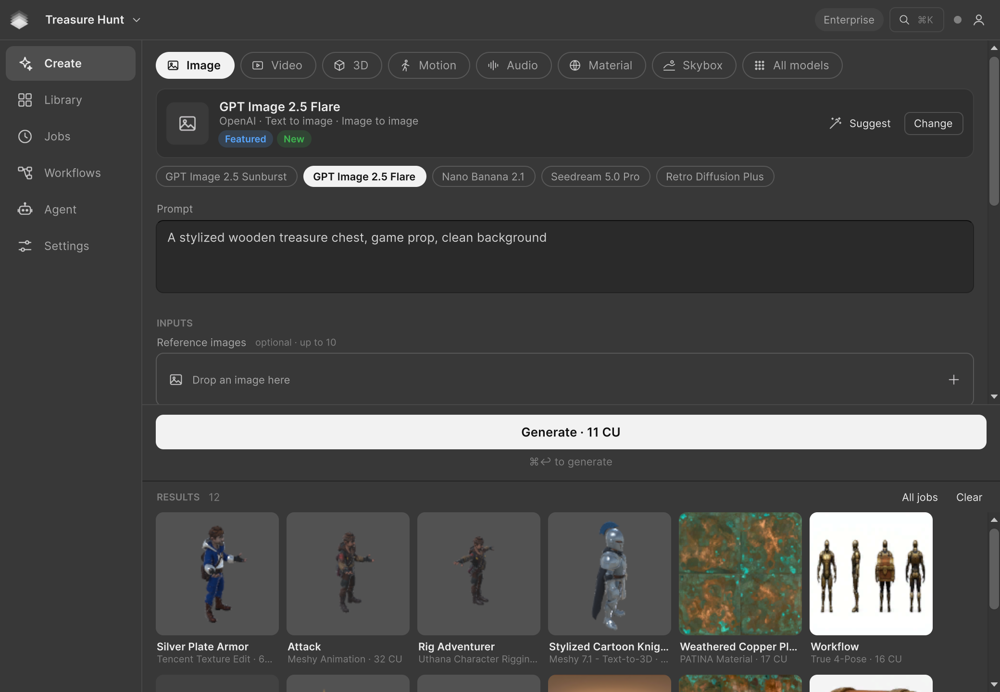

# Scenario for Unity

Generate images, video, 3D models, PBR materials, skyboxes and audio with every [Scenario](https://scenario.com) model, from a window inside the Unity Editor. You see the price in Creative Units (CU) before anything is spent, and the result lands in your project as a wired Unity asset: a sprite on the selected renderer, a prefab at the Scene view pivot, a material on the selected mesh, the scene's skybox. AI agents such as Claude Code, Codex and Cursor can drive the same actions through a local MCP server in the editor.



**Version 0.1.0** <!-- x-release-please-version -->. Unity 6.0 or later. Tested on Unity 6.3 (6000.3.21f1) with URP on macOS. Editor only: nothing from the package ships in a player build. MIT license.

## Install

In Unity, open **Window > Package Management > Package Manager**, press **+**, choose **Install package from git URL** and paste:

```
https://github.com/scenario-labs/unity-plugin.git?path=/Packages/com.scenario.unity
```

Add `#unity-plugin-v0.1.0` at the end to pin a release. <!-- x-release-please-version --> The package pulls in glTFast (Unity's GLB importer) and Newtonsoft JSON.

Then open **Window > Scenario** (Alt+Shift+S).

## Sign in

- **Sign in with Scenario** opens your browser, you approve, and the window lists your teams and projects. Generations are billed to the project you pick.
- **Use an API key instead**: paste the key and secret from the Scenario web app (or `key:secret` in one go). The key is tied to one project.
- **CI and batch mode**: set `SCENARIO_API_KEY` and `SCENARIO_API_SECRET`.

Secrets never go into your Unity project: they live in the macOS Keychain or the Windows Credential Manager (service "Scenario Unity Plugin"), or, elsewhere, in a file readable by your user only.

## What you can make

| Type | Quick picks (the whole catalog is one click away) | Lands as |
|---|---|---|
| Image | GPT Image 2.5 Sunburst, GPT Image 2.5 Flare, Nano Banana 2.1, Seedream 5.0 Pro, Retro Diffusion Plus | a texture or sprite, set on the selected SpriteRenderer, UI Image, RawImage or renderer, or a new quad or sprite |
| Video | Minimax H3, Gemini Omni 1.1 Flash, Wan 3.0, Seedance 2.5 | a VideoClip on the selected VideoPlayer, or a new screen quad |
| 3D | Meshy 7.1, Rodin Gen-2.5, Hunyuan 3D 3.1 Pro, Tripo P2, Meshy T2.5 Smart Topology | a GLB imported as a prefab, placed on the ground at the Scene view pivot, optional MeshCollider |
| Audio | Mirelo SFX 2.0, ElevenLabs Sound Effects 2, Sonilo V1.1, ElevenLabs Music v2.5, Gemini 3.8 Flash TTS | an AudioClip on the selected AudioSource, or a new one |
| Material | PATINA Material, PATINA Image to Maps, PATINA Material Extract | a material for your render pipeline (Built-in, URP, HDRP) with normal, height and packed metallic and smoothness maps, set on the selected renderers |
| Skybox | Scenario Skybox GPT, Scenario Skybox Flux, HY World Image to Skybox | a Skybox/Panoramic material set as the scene's skybox |
| All models | every model in the catalog, plus your team's own | by the kind of file it returns |

**Suggest** ranks the best models for your prompt. **Change** opens the model browser: search, favorites, team models. The settings form is built from each model's live schema, essentials first.

**Next steps** turn any asset into the next one: an image into a 3D model, a video, a material, a skybox, or a cleaner image (remove background, upscale, vectorize, pixelate, edit by prompt); a 3D model into a retextured, retopologized, UV-unwrapped, rigged or split one; a video into an upscaled or restyled one, or one with sound; a voice into a changed or isolated one. They are on result cards, on a right-click in the Project window (**Scenario > Next Step**) and in the Inspector of any generated asset.

**Workflows** lists your team's Scenario workflows and the featured public ones; their inputs become a form with a price.

**Library** browses your Scenario project's assets and imports any of them. Its second tab lists every asset in this Unity project that came from Scenario.

## Agents

Turn on **Agent** in the window to let a local AI agent use Scenario and your scene. The editor then serves an MCP server on `http://127.0.0.1:8791/mcp`, with a bearer token kept on your machine. The Agent view gives the setup line for Claude Code, Codex, Cursor and VS Code (and runs it for Claude Code).

The agent gets Scenario tools (find a model, price, generate, workflows, jobs, import, upload) and scene tools (inspect the hierarchy, create and change objects and components, assign materials, set the skybox, save, read the console, capture the Scene view as an image it can look at). Every scene edit is one Undo step. Paid calls above a per-call limit (20 CU by default) or beyond a session budget (300 CU) wait for your approval in the window.

## Editor scripts and CI

```csharp
using Newtonsoft.Json.Linq;
using Scenario;

var price = await ScenarioApi.Estimate("model_openai-gpt-image-2-5-flare", new JObject { ["prompt"] = "A rune stone icon" });
var result = await ScenarioApi.Generate("model_openai-gpt-image-2-5-flare", new JObject { ["prompt"] = "A rune stone icon" }, maxCu: 20);
Debug.Log(string.Join(", ", result.Files)); // Unity asset paths
```

`Generate` prices first and refuses, without sending, anything above `maxCu`.

## Spending rules

- **Price first.** The button reads `Generate · 11 CU`, from a free price check of the exact request. Change anything and the price is checked again.
- **One click, one paid request.** Each price is used once, and a paid request is never retried.
- **Uncertain means Unknown.** If the connection drops while a paid request is being sent, the job is marked Unknown and the same request is blocked until it is matched on Scenario, so a network glitch cannot charge you twice.
- **Confirmation** above a threshold (100 CU by default, in Settings).
- **Spending switch**: in Settings, or `SCENARIO_NO_SPEND=1` for the whole editor. Price checks, browsing and imports still work.
- Moderated requests show as Blocked and are never resent.

## Where files go

Results go to `Assets/Scenario/<Type>/<date>/`, named after the prompt, for example `Assets/Scenario/Image/2026-10-18/stylized-wooden-treasure-chest-a1b2c3.png`. Each asset records its model, prompt, job and cost in its `.meta` file, carries the `Scenario` label, and shows them in the Inspector. The job list lives in `Library/Scenario/jobs.json`, on your machine only.

## Documentation

- [User guide](Packages/com.scenario.unity/Documentation~/USER_GUIDE.md): every view step by step, job states, troubleshooting.
- [Agent skill](Packages/com.scenario.unity/Documentation~/agent-skill/SKILL.md): what an agent should know to use the bridge well.
- [Changelog](Packages/com.scenario.unity/CHANGELOG.md), [roadmap](ROADMAP.md).

## Development

The repository root is a Unity 6.3 project that hosts the package (`Packages/com.scenario.unity`) and its tests; [AGENTS.md](AGENTS.md) has the code map and rules. Run the EditMode tests from the Test Runner window, or in batch mode:

```sh
Unity -batchmode -projectPath . -runTests -testPlatform EditMode -testResults results.xml
```

The window tests need a graphics device and are skipped under `-nographics`. Two live checks run from `Assets/ScenarioDev/Editor` with `-executeMethod` and the test key in `SCENARIO_API_KEY` and `SCENARIO_API_SECRET`: `ScenarioDev.ContractCheck.Run` (free, needs `SCENARIO_NO_SPEND=1`) prices every quick pick, step and a set of workflows; `ScenarioDev.Acceptance.Run` (paid, needs `SCENARIO_ACCEPT=1`) runs one generation per type and records it in `tests/live/LEDGER.md`.

## License

[MIT](LICENSE).
